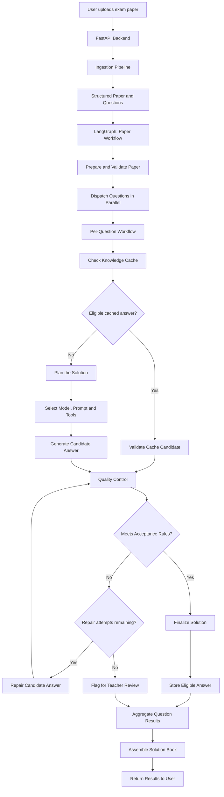

# AnswerBook Architecture Overview

## 1. Purpose

AnswerBook transforms scanned or digital exam papers into structured solution books containing answers, step-by-step explanations, mark distributions, and common mistakes.

The system uses **FastAPI, LangGraph, configurable LLM providers, and PostgreSQL** to process papers and solve their questions.

The architecture is designed to support multiple model providers, different prompt versions, verification strategies, and tools without requiring changes to the core workflow whenever a model or provider changes.

> **Implementation status:** This document describes the target architecture. Components may still need to be implemented or integrated into the current codebase.

## 2. System Architecture at a Glance

The system is divided into four main layers.

1. **Paper Processing:** Receives the paper and prepares structured questions.
2. **Question Solving:** Plans and generates a solution for each question.
3. **Quality Control:** Validates, verifies, and repairs generated answers.
4. **Storage and Results:** Reuses eligible cached answers, stores accepted solutions, and assembles the final paper.

## 3. Layer One: Paper Processing

**Responsibility:** Convert the uploaded document into structured data that the solver can understand.

### Components

- **FastAPI Backend:** Receives the uploaded file and initiates processing.
- **Ingestion Pipeline:** Extracts text, question boundaries, options, marks, sections, and relevant metadata using the appropriate document-processing tools.
- **Paper Model:** Represents the paper and its questions using validated data models.
- **Graph Adapter:** Converts the extracted paper into the initial state required by LangGraph.

### Output

A structured paper containing information such as:

- Paper ID, subject, class, and board.
- Question number and question text.
- Marks, options, section, and chapter information.
- Figure references and page information, where available.

**Important:** A flag such as `has_figure=True` does not provide the figure itself. Questions requiring visual interpretation must also have access to the actual image, crop, or equivalent visual input.

## 4. Layer Two: Question Solving

**Responsibility:** Determine how to solve each question and generate a candidate answer.

The paper workflow dispatches independent questions as separate work items. This allows multiple questions to be processed concurrently, subject to provider rate limits and configured concurrency limits.

Each question follows its own workflow.

### Step 1: Inspect the question

Collect the question text, marks, options, paper context, and available visual information.

### Step 2: Check the knowledge cache

Search for a potentially reusable answer based on the question and its relevant context.

A cache match is only a candidate. It must satisfy the cache eligibility rules and any required validation before reuse.

### Step 3: Plan the solution

Determine the capabilities and resources needed for the question, considering:

- Question complexity and expected depth of reasoning.
- Marks and expected answer length.
- Need for image interpretation.
- Availability of suitable tools.
- Cost, latency, and model availability.

The planner selects a suitable configured model, prompt version, and required capabilities. It does not rely exclusively on a fixed mapping from question type to solver.

### Step 4: Generate the candidate answer

The selected model produces a structured candidate containing the answer, explanation steps, mark distribution, common mistakes, and other required fields.

The candidate is not considered correct merely because the model generated valid JSON.

## 5. Layer Three: Quality Control

**Responsibility:** Determine whether the candidate answer satisfies the requirements for acceptance.

### Validation

Validation checks whether the output is structurally and logically consistent.

Examples include:

- Required fields are present and have valid types.
- The answer addresses the question asked.
- The mark distribution is compatible with the question's marks.
- The final numerical answer agrees with available calculations.
- An MCQ answer corresponds to an available option.
- Required steps and subparts have not been omitted.

Where deterministic checks are possible, they should be preferred over asking another LLM to judge everything.

### Independent verification

Verification assesses whether the answer is likely to be correct.

It may combine deterministic checks, domain-specific tools, reference material, and an independent model review.

The verifier should return a structured outcome, reasons, and actionable feedback. Using a different model or provider can improve independence, but it does not guarantee correctness.

### Repair and retry

If an answer fails a repairable check, the workflow can send the candidate and the identified problems back for correction.

Every repaired answer must be validated and verified again.

Retries must be bounded to prevent excessive latency, API usage, and repeated failures.

### Final decision

Each question receives one of three final outcomes:

| Outcome | Meaning |
|---|---|
| `completed` | The answer satisfies the configured acceptance policy. |
| `needs_review` | A candidate exists, but correctness or completeness remains uncertain. |
| `failed` | No usable answer could be produced within the configured limits. |

Confidence scores should be treated as operational estimates unless they have been calibrated against labelled evaluation data.

## 6. Layer Four: Storage and Results

**Responsibility:** Persist eligible answers and produce the final solution book.

### Knowledge cache

PostgreSQL stores reusable solutions and associated metadata.

A solution should be eligible for trusted reuse only when it meets the configured policy, including relevant verification requirements, contextual compatibility, and teacher-review restrictions.

### Conditional storage

The workflow stores a generated answer only when the configured storage rules are satisfied.

Useful audit metadata includes:

- Provider and model ID.
- Prompt and workflow version.
- Verification outcome and checks performed.
- Confidence assessment and its method.
- Attempt count and cache decision.
- Relevant timestamps and provenance.

A failed or unverified answer must not silently become a trusted cached solution.

### Result aggregation

After question processing finishes, the parent graph:

1. Collects the results from all dispatched questions.
2. Detects missing, duplicate, or unexpected results.
3. Restores the original question order.
4. Determines the overall paper status.
5. Prepares the structured output for the solution book.

One failed question should not automatically erase successful results from other questions.

## 7. Provider-Independent Model Layer

The solving workflow should communicate with models through application-level interfaces rather than directly depending on vendor-specific SDKs.

The provider layer is responsible for translating requests and normalizing responses.

| Capability | Responsibility |
|---|---|
| Text generation | Generate explanations and candidate solutions. |
| Structured output | Return data matching the required solution contract. |
| Vision | Interpret actual images, figures, and diagrams. |
| Tool use | Request approved operations where supported. |
| Image generation | Create a new image or diagram where supported. |

Groq, Gemini, Qwen-hosting services, and other compatible providers can be integrated through adapters, provided the selected service and model support the required capability.

Vision and image generation are separate capabilities. The architecture must check support rather than assume every model can perform every task.

## 8. State Management

Each question should retain enough information for the workflow to resume, diagnose failures, and evaluate quality.

A question work item should include:

- **Identity:** Work-item ID and original question index.
- **Input:** Question text, marks, options, and relevant paper context.
- **Visual context:** Figure references or image data, when available.
- **Planning:** Selected capabilities, provider, model, and prompt version.
- **Generation:** Candidate answer and attempt count.
- **Quality control:** Validation results, verification outcome, reasons, and confidence assessment.
- **Persistence:** Cache status and storage decision.
- **Finalization:** Final status, solution, and error information.

The parent paper state should track paper metadata, dispatched work items, collected results, and the overall processing status.

The exact field names must remain consistent with the implemented Pydantic models and LangGraph state definitions.

## 9. Design Principles

1. **Modularity:** Each component has a clearly defined responsibility.
2. **Provider independence:** Model providers can change without rewriting the workflow.
3. **Capability-based planning:** Model selection depends on the task's requirements, not just its declared question type.
4. **Quality before persistence:** Generated answers must pass the applicable acceptance and storage policies.
5. **Bounded execution:** Model calls, repair attempts, and concurrency are controlled.
6. **Explicit failures:** Unsupported capabilities and failed checks must not be hidden behind successful-looking placeholder results.
7. **Auditability:** Important model decisions and verification outcomes are recorded.
8. **Testability:** Components can be tested independently with mock providers and repositories.
9. **Measurable quality:** Prompt and model changes are evaluated against a consistent dataset and rubric.

## 10. Summary

The core architecture separates paper processing, per-question solving, quality control, and persistence.

The parent LangGraph coordinates paper-level execution, while each question follows an independent workflow. A provider-independent model layer allows different models to be selected for planning, solving, verification, and vision. Finally, validation, verification, and conditional storage help prevent unreliable generated answers from being treated as trusted solutions.

The target is not simply to generate an answer for every question. It is to produce **structured, traceable, and appropriately verified solutions**, while making failures visible and allowing the system to improve through systematic evaluation.
