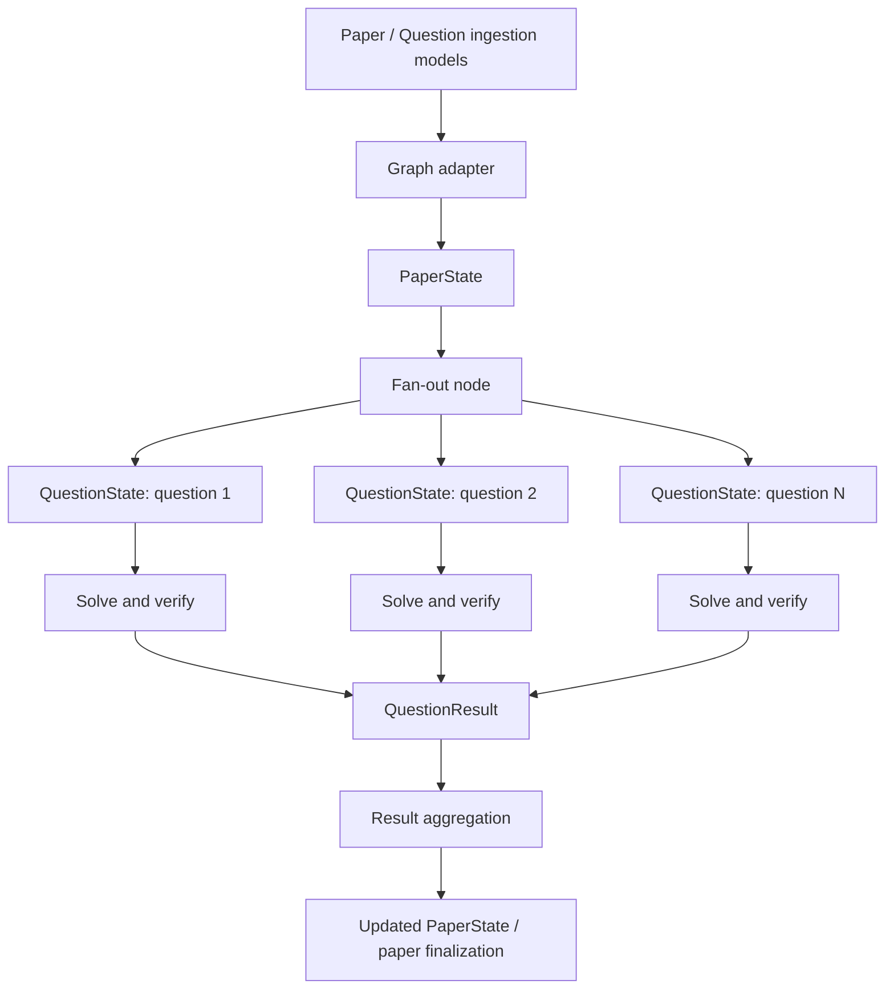

# AnswerBook: Graph State Definitions and Responsibilities

## 1. Purpose

This document defines the state structures used by the AnswerBook question-solving workflow, describes the responsibility of each state, and explains how state is transferred between ingestion, paper orchestration, question processing, verification, and result aggregation.

The state definitions form the data contract between graph nodes. They specify the information a node may receive, maintain, or return; they do not implement the processing logic themselves.

## 2. Scope

The workflow distinguishes three levels of data:

1. **Ingestion data** — the validated paper and question models produced by the ingestion pipeline.
2. **Execution state** — the paper-level and question-level data used while the LangGraph workflow runs.
3. **Result data** — the normalized solution and processing outcome returned by a question worker.

The parent graph operates on `PaperState`. Each question worker operates on a `QuestionState`. The adapter initializes the parent state from the ingestion model, and the parent graph dispatches individual question work items to workers.

## 3. State-flow overview



The fan-out node must explicitly dispatch each work item, for example by using LangGraph's `Send` mechanism. LangGraph does not automatically create one worker execution for each item in a list.

## 4. State and data definitions

### 4.1 `Paper` and `Question` — ingestion models

**Role:** Represent the validated output of the ingestion pipeline.

- `Question` contains extracted question content and associated attributes, such as question number, text, type, marks, options, page, figure indicator, section, choice group, section title, and chapter.
- `Paper` contains paper identity, fingerprint, ingestion status, paper metadata, the question collection, and optional declared totals.

These are Pydantic ingestion models, not LangGraph execution states. The graph adapter reads them and constructs the initial `PaperState`.

### 4.2 `QuestionInput` — question content schema

**Role:** Define the question content required by the question-solving workflow, independently of execution bookkeeping.

The schema includes:

- `number`
- `section`
- `text`
- `marks`
- `type`
- `options`
- `has_figure`
- `page`
- `choice_group`
- `section_title`
- `chapter`

This schema separates the source question from runtime fields such as attempts, routing, cache status, verification results, and errors. Since the ingestion `Question` model already represents most of this information, the implementation should retain `QuestionInput` only if the explicit graph-facing contract is useful to the project.

### 4.3 `QuestionWorkItem` — dispatchable question unit

**Role:** Represent one question prepared for execution by the parent graph.

A work item combines question content with identity and initialized execution fields.

| Field | Responsibility |
|---|---|
| `work_item_id` | Identifies the processing item within the paper. |
| `question_index` | Records the zero-based source order. |
| `selected_route` | Records the route selected by the routing node. |
| `attempts` | Tracks solving attempts used. |
| `max_attempts` | Defines the maximum number of solving attempts. |
| `raw_solution` | Stores the intermediate solver response. |
| `verification` | Stores the verification outcome and related checks. |
| `confidence` | Stores the confidence value produced by the workflow. |
| `cache_status` | Tracks the cache/database lookup state. |
| `solution` | Stores the final normalized solution when available. |
| `error` | Stores an error associated with processing the question. |

The adapter creates one work item for each ingested question and preserves the original order. A deterministic identifier may be formed from the paper ID and question index, for example `paper-001:q:0000`. Such an identifier remains stable only while the paper ID and ordering remain stable.

`max_attempts = 2`, if retained as the initial policy, means two total attempts including the first attempt. The project should keep this meaning consistent throughout retry logic.

### 4.4 `QuestionState` — individual worker state

**Role:** Define the state used by one question-solving graph execution.

A `QuestionState` represents one question, not the entire paper. It carries the question's content and execution fields while routing, solving, verification, retry, and finalization nodes run.

A typical processing lifecycle is:

1. **Initialized:** The worker receives one question work item.
2. **Routed:** The workflow selects the applicable solver route.
3. **Solved:** A solver produces an intermediate answer.
4. **Verified:** Verification checks are executed and their outcome is recorded.
5. **Finalized:** The worker produces a normalized solution or records a failure/review outcome.

The state schema describes the information available at each stage. Graph nodes implement the lifecycle operations.

### 4.5 `VerificationState` — verification record

**Role:** Record the status and details of answer verification.

The proposed status values are:

- `not_checked`
- `passed`
- `failed`
- `needs_review`

The record may also contain verification reasons and structured check results. Verification logic—such as which checks are applied and how their outcomes affect confidence—is implemented by the verification nodes.

The presence of a generated answer does not, by itself, imply that verification has passed.

### 4.6 `CommonMistakeItem` — common-mistake entry

**Role:** Represent one common mistake associated with a solution.

Fields:

- `wrong`: the incorrect approach, answer, or misconception.
- `why`: an explanation of why it is incorrect.

A solution may contain multiple common-mistake entries.

### 4.7 `MarkSplitItem` — marking allocation entry

**Role:** Represent the marks allocated to a specific step or criterion in the solution.

Fields:

- `marks`: marks allocated.
- `for`: the step or criterion receiving those marks.

The output key must remain exactly `"for"` to preserve the solution contract. Because `for` is a Python keyword, define the `TypedDict` using functional syntax:

```python
MarkSplitItem = TypedDict(
    "MarkSplitItem",
    {
        "marks": int,
        "for": str,
    },
)
```

### 4.8 `SolutionContract` — normalized solution output

**Role:** Define the stable final output format for one solved question.

The contract contains:

- `question_number`
- `answer`
- `steps`
- `mark_split`
- `common_mistakes`
- `confidence`
- `verified_by`
- `needs_teacher_check`

The contract is the boundary between internal question processing and downstream consumers of the solution. Internal prompts, solver implementations, and routing may change without changing this output shape. The field names and types should be kept consistent with the project's frozen output contract.

### 4.9 `QuestionResult` — worker result envelope

**Role:** Represent the outcome returned by a question worker in a form that the parent graph can aggregate.

The proposed fields are:

- `work_item_id`
- `question_index`
- `question_number`
- `solution`
- `status`
- `error`

The work-item ID and index associate the result with the correct source question, including when display question numbers are duplicated. The project should define the permitted result statuses and their exact meanings consistently across workers and the aggregation node.

### 4.10 `PaperMetadata` — paper-level descriptive metadata

**Role:** Keep paper-wide descriptive fields separate from individual question execution state.

The schema contains:

- `subject`
- `class_name`
- `board`
- `total_marks`
- `sections`
- `declared_total_questions`

`declared_total_questions` preserves the optional value supplied by ingestion. It is distinct from the actual count of work items created from the question collection.

### 4.11 `PaperState` — parent orchestration state

**Role:** Represent the state of the complete paper as it moves through the parent graph.

The state contains:

- `paper_id` and `fingerprint`
- paper `status`
- `paper_metadata`
- `questions`: all initialized `QuestionWorkItem` entries, in source order
- `total_questions`: the actual number of work items
- `current_index`: parent-level progress information, if used by the orchestration design
- `results`: collected `QuestionResult` entries
- `errors`: paper-level errors

`PaperState` coordinates the workflow; it does not itself solve the questions. The recommended design keeps the initialized `questions` collection separate from the collected `results` collection. Parallel workers should not mutate a shared list in place. Result collection should use an explicitly defined LangGraph reducer or aggregation node.

## 5. Responsibilities by workflow component

| Component | Input | Responsibility | Output |
|---|---|---|---|
| Ingestion | Source paper | Extract and validate paper and question data | `Paper` containing `Question` objects |
| Graph adapter | `Paper` | Initialize metadata, work-item identity, order, and execution fields | Initial `PaperState` |
| Fan-out node | `PaperState` | Dispatch one work item per question worker | Worker invocations with individual question inputs |
| Question-solving graph | One `QuestionState` | Route, solve, verify, retry when allowed, and finalize one question | `QuestionResult` |
| Aggregation node | Worker results and parent state | Collect results and associate them with source order | Updated parent result collection |
| Paper finalization | Aggregated `PaperState` | Determine the paper-level outcome according to defined lifecycle rules | Final paper state/output |

## 6. Adapter contract

The adapter function, `paper_to_graph_state(paper: Paper) -> PaperState`, is responsible for deterministic state initialization.

It should:

1. Read the validated `Paper` model without mutating it.
2. Convert each question to ordinary Python data.
3. Preserve all question fields and optional values.
4. Assign a work-item ID and zero-based source index.
5. Initialize execution fields, including attempts, route, verification, cache status, solution, and error.
6. Preserve paper-level metadata.
7. Set `total_questions` to the actual number of ingested questions.
8. Initialize result and error collections.
9. Perform no LLM calls, solving, database access, or other I/O.

Routing, solving, verification, cache lookup, retry decisions, and result aggregation are responsibilities of later graph nodes.

## 7. Implementation notes

### 7.1 Static typing and runtime validation

`TypedDict` describes dictionary shapes for static type checking; it does not validate data at runtime. Pydantic ingestion models validate the incoming paper. If runtime validation of worker states or results is required, add explicit validation at graph boundaries or use dedicated Pydantic models for those contracts.

### 7.2 Required fields and partial graph updates

Using `total=False` permits fields to be omitted from the type-checking perspective. This may be convenient for partial graph updates, but it weakens guarantees about complete initial states. The implementation should clearly distinguish a fully initialized state from partial node updates.

### 7.3 Cache and database processing

The initial `cache_status` value `not_checked` means the lookup node has not yet executed. Subsequent processing may record a hit, miss, or error. Cache hits, confidence thresholds, verification requirements, and database write eligibility must be defined by the cache/database workflow rather than by the state schema alone.

### 7.4 Figure references

A `has_figure` boolean indicates whether a question has a figure, but does not provide the figure asset itself. If solving requires the image, the workflow must supply a figure reference, storage URI, or other defined asset-retrieval mechanism.

### 7.5 Paper status lifecycle

The ingestion status values and the graph's final processing status should have clearly defined transitions. The project should specify how partial failures, verification failures, and teacher-review cases affect the final paper status.

## 8. Summary of state roles

| State/model | Scope | Primary role |
|---|---|---|
| `Paper` | Ingestion | Validated paper data |
| `Question` | Ingestion | Validated question data |
| `QuestionInput` | Question | Question content contract |
| `QuestionWorkItem` | One question | Dispatchable question plus initialized execution fields |
| `QuestionState` | One worker | Live state for solving and verifying one question |
| `VerificationState` | One question | Verification status and check details |
| `CommonMistakeItem` | One solution entry | Describes a common incorrect approach and why it is wrong |
| `MarkSplitItem` | One solution entry | Allocates marks to a step or criterion |
| `SolutionContract` | One question result | Stable normalized solution format |
| `QuestionResult` | One worker result | Associates outcome with work-item identity and source order |
| `PaperMetadata` | One paper | Paper-wide descriptive metadata |
| `PaperState` | Entire paper | Parent orchestration state and collected results |

## 9. Architectural decision

The intended separation is:

- `PaperState` contains the paper and all initialized question work items.
- `QuestionState` represents the execution of one question.
- `QuestionResult` is the standardized worker outcome used for aggregation.
- `SolutionContract` is the stable normalized answer format.
- The adapter initializes state; graph nodes perform routing, solving, verification, retry, cache/database processing, aggregation, and finalization.

The documentation defines responsibilities and data flow. The concrete schemas must remain aligned with the repository's actual model imports, LangGraph node signatures, reducers, and frozen output contract.
